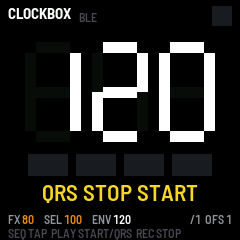
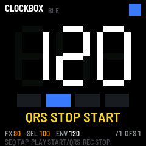
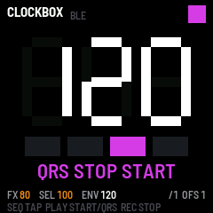
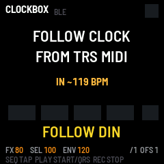
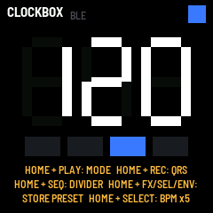
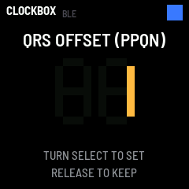

# CLOCKBOX for the M-VAVE FM-1

A port of [ClockBox v3](https://github.com/Andymann/clockbox-v3) (firmware 3.55, [socialmidi.com](https://socialmidi.com)) to the FM-1. The FM-1 becomes a tight 24 PPQN MIDI master clock. It has:

- Quantized Restart (QRS)
- two follow modes
- tap tempo
- three tempo presets
- a sync pulse on the audio output

 

## What goes where

| ClockBox v3 | FM-1 |
|---|---|
| 6 × TRS MIDI out + USB MIDI | **USB MIDI + Bluetooth MIDI** (the FM-1 has no MIDI out jack) |
| TRS MIDI in | the TRS MIDI in jack (called "DIN" in the modes) |
| CV clock / CV start jacks | the **audio out** when SYNC OUT is on: left channel = clock pulse, right channel = playhead reset pulse after a stop |
| TAP | **SEQ** |
| PLAY (START) | **PLAY** |
| STOP | **REC** |
| PRESET 1 / 2 / 3 | **FX / SEL / ENV** |
| encoder (turn) | **SELECT** (±1 BPM), **ALGO** (±5 BPM) |
| encoder click (held) | **HOME** (held) |
| 4 beat LEDs + clock-in LED | the screen, in the ClockBox's colours, plus the LEDs of keys F3 G3 A3 B3 (beats) and C4 (clock in) |
| — | **PLAY's LED**: green while playing, red while a restart waits |
| — | **EDIT**: SYNC OUT on / off |
| — | **OCT− / OCT+** held: nudge the tempo −7.5 % / +7.5 % while held (in the ClockBox source, unused there) |

## Basic use

When switched on, CLOCKBOX shows its version for 2 seconds. Then the clock runs: MIDI clock (`F8`) goes out continuously, even while stopped, so your gear can lock to the tempo before you press PLAY.

- **Tempo:** turn SELECT (±1), turn ALGO or hold HOME and turn SELECT (±5), or tap SEQ 4+ times. The range is 30–300 BPM; tap tempo reaches 240.
- **PLAY:** sends MIDI Start; the clock starts at beat 1.
- **REC (STOP):** sends MIDI Stop.
- **Presets** FX / SEL / ENV:
  - a press jumps to the stored BPM
  - a hold of 1 s fades to it (one sixteenth of the way per sync step; the screen turns cyan)
  - HOME + a press stores the current BPM

## QRS: Quantized Restart

Press **PLAY while the clock is running**. The beat lights turn purple and PLAY's LED turns red. On the next downbeat, every connected device gets a Start (and, in QRS STOP START, a Stop just before it) and snaps back in sync without the music stopping.

## Modes: HOME + PLAY cycles them (saved at once)

| Mode | What it does |
|---|---|
| **QRS STOP START** (default) | master clock; the restart sends Stop `QRS offset` ticks before the one, then Start on it |
| **QRS START** | master clock; the restart sends Start only |
| **FOLLOW DIN** | clock, Start and Stop from the TRS MIDI in are passed straight to USB and Bluetooth; the internal clock is off |
| **FOLLOW USB** | the same from USB MIDI, passed on to Bluetooth |

In the follow modes, PLAY arms a restart that sends Start on the next downbeat counted in. The screen shows the incoming tempo.

## Settings: hold the buttons, turn SELECT, release to keep

The settings flash red to confirm they're saved.

| Hold | Setting | Range |
|---|---|---|
| HOME + REC | **QRS offset**: ticks between the Stop and the Start | 1–24 (default 1; 2 is the ClockBox's recommended setting for Ableton) |
| HOME + SEQ | **Clock divider** of the sync pulse (/1 = every 6 ticks, a 16th note) | /1 /2 /4 /8 /16 /32 /64 |
| PLAY + REC | **LED brightness** | 10–200 |

Holding HOME shows these combinations on the screen.

 

## Sync out (the CV jacks' stand-in)

Press **EDIT** to switch SYNC OUT on. The headphone/line output then carries:
- **left:** a clock pulse at the divider's rate, while playing
- **right:** a reset pulse after a Stop

MASTER sets the pulse level. Use it for Volca / Pocket Operator style sync inputs. The speaker plays the pulses too, so keep it off when you don't need it.

## Update mode

Hold **REC** while switching on: the screen shows UPDATE MODE and no MIDI goes out. Switch off and on to leave. Firmware updates themselves work in any mode (USB-MIDI updater).

## Saved settings

These persist across power cycles:

| Setting | Default |
|---|---|
| Presets | 80, 100, 120 BPM |
| Mode | QRS STOP START |
| QRS offset | 1 |
| Clock divider | /1 |
| LED brightness | 50 |
| Sync out | off |

The tempo itself starts at 94 BPM, as on the ClockBox.

## Differences from ClockBox v3, and why

- MIDI goes out on USB and Bluetooth; the FM-1 has no MIDI out jacks. In FOLLOW USB, the clock goes on to Bluetooth (the ClockBox sends it to its TRS outs).
- The sync output is on the audio jack, pulses at most 15 ms long, so AC-coupled outputs don't droop.
- Combinations never also trigger the single-button action. On the ClockBox, releasing the buttons in a certain order could start the clock.
- Storing preset 2 stores preset 2. In ClockBox 3.55 it overwrote preset 1's value (a bug in `preset2ClickHandler`).
- The tempo is limited to 30–300 BPM. TapTempo's beat length is rounded to the nearest ms rather than truncated, so 245–300 BPM don't creep up a step.
- Switching between the two QRS modes keeps the bar position. The ClockBox restarted its internal tick counter.
- Timing: the clock runs in a 1 ms timer interrupt against the 24 MHz crystal (jitter under 1 ms, no drift). Saving a setting pauses interrupts briefly; the clocks that fall due meanwhile are sent right after.
